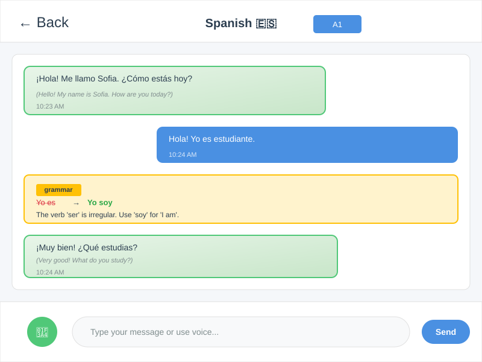

## Hi there, I'm Pieter Kuppens

🇳🇱 [Lees dit in het Nederlands — LEESMIJ.md](LEESMIJ.md)

Experienced software, data, and AI professional. One professional, end-to-end—architecture, development, testing, deployment, process, and AI automation.

**Why / what / how** — I make AI solutions production-ready in regulated environments, where data must not leave the organization. From architecture and Python engineering to testing, CI/CD, and on-prem/Kubernetes deployment: one professional for the full chain. 20+ years across high-tech (ASML), healthcare (Philips Healthcare, Nemo Healthcare, CART-Tech), and finance (ABN AMRO).

**Signature skills** — AI systems: deep learning · NLP · agents · on-prem RAG & LLM systems · MLOps & data pipelines · Python backend engineering (FastAPI) · data processing · air-gapped / on-prem deployment (Docker, Kubernetes) · test & quality discipline.

[Read the full value proposition →](docs/profile/value_proposition_demo_plan.md)

## Availability

Availability on request—near Den Bosch, remote, or hybrid. Sector focus: Healthcare, Finance, Energy, High-Tech. Contract type negotiable.

## Signature Projects

### 🔒 [On-Premise RAG System](https://github.com/pkuppens/on_prem_rag)

On-premise RAG for semantic search on your documents. Vector embeddings, semantic search, and LLM capabilities—all data stays on-premises (on-prem, air-gapped, GDPR-friendly). Built for healthcare, finance, and legal where data sovereignty matters.

   

**Status**: 🟢 Active Development

---

### 🗣️ [Babblr: AI Language Learning](https://github.com/pkuppens/babblr)

Natural conversation over gamification. Adaptive AI tutor with real-time grammar and vocabulary support. Electron, FastAPI, Whisper, Claude. Spanish, Italian, German, French, Dutch—CEFR A1–C2.

    

**Repository**: [github.com/pkuppens/babblr](https://github.com/pkuppens/babblr) · **License**: AGPL-3.0 · **Status**: 🟢 Active Development

---

### 🧩 AI Coding Skills Library

A unified skills library for Cursor, Claude, and Codex—arc42-aligned workflows from ideation to deployment. 16 top-level skills and 60+ battle-tested sub-skills, validated in CI. Browse the [SKILL_TREE.md](skills/SKILL_TREE.md) index.

## Software Development Discipline

This repo follows a platform-agnostic development workflow documented in [docs/workflow/README.md](docs/workflow/README.md). Platform-specific details reference it as the canonical source of truth:

- [GitHub](docs/workflow/github.md)
- [Azure DevOps](docs/workflow/azure-devops.md)

## Earlier Career

Software development at ASML (EUV metrology, source positioning), Philips Healthcare (3D ablation visualization), ABN AMRO (mortgage, security), and Mapscape (GIS/navigation). Recent AI work: Deep Learning for cardiac tissue segmentation at CART-Tech (pacemaker lead placement); migration to AWS for model scalability. JIRA/Confluence workflows for medical device (Nemo Healthcare). AI anomaly detection for financial transactions. Medication decision rules and hospital data integration (Isatis, Nemo).

## Education

- **Eindhoven University of Technology** — MSc in Mathematics; PDEng in ICT (Information & Communication)

## Certifications & Training

- **AWS Cloud Practitioner**
- **Microsoft Professional Program in Data Science** (2017–2018)
- Several AI/ML trainings
- Ongoing learning via PluralSight, DataCamp, etc.

## Interests

- AI and data: Deep Learning, LLMs, ML, agentic systems
- (Backend) software engineering—primarily Python, also C#/.NET, C++, and SQL (AI is 80% software/data engineering anyway)
- Healthcare, finance, energy, high-tech
- Technical collaboration and continuous improvement

## Links

- [Connect on LinkedIn](https://www.linkedin.com/in/pieterkuppens/)
- [Visit my site](https://www.pieterkuppens.net/)

---

*Explore my repositories—and connect on LinkedIn or pieterkuppens.net to discuss opportunities.*
